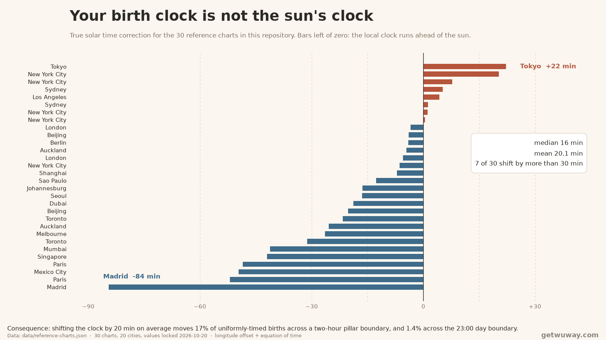

# BaZi reference charts — 30 charts with locked expected values

[](https://getwuway.com/benchmark)
[](https://getwuway.com/tests)
[](./LICENSE)
[](./LICENSE-DATA)

A small, reproducible test set for Four Pillars (BaZi / 八字) chart calculation.
Thirty birth moments with the four pillars, the true solar time each chart was
built from, and element weights — plus every expected value cross-checked by a
**second implementation that shares no code with the first**.

The point is narrow on purpose: the *four pillars are arithmetic*, not
interpretation. If two calculators disagree on them, one of the two is wrong.
This repository gives you a fixed set of inputs and answers so that disagreement
is measurable instead of arguable.

Last regenerated: **2026-10-20**.

## What is in here

    data/reference-charts.json   30 cases: input, expected, both implementations' output
    data/results.json            the summary line, regenerated with the data
    engine/                      the reference engine (MIT), vendored so results reproduce
    harness/run.mjs              re-run every case against the locked values
    harness/compare.mjs          score your own calculator against the same values

No dependencies. No network. Node 18+.

## Run it

```bash
node harness/run.mjs
```

    30/30 cases match their locked expectations

Exit code 0 on a full match, 1 otherwise, with the failing ids printed.

## Score your own calculator

```bash
node harness/compare.mjs my-results.json
```

where `my-results.json` maps case id to the four pillars you produce:

```json
{ "1": { "year": "庚午", "month": "辛巳", "day": "乙酉", "hour": "癸未" } }
```

Only the pillars are compared. Element weights are deliberately excluded —
the weighting coefficients differ between schools and are a modelling opinion,
while the pillars are not. A benchmark that mixes the two measures nothing.

## The rules this set assumes

Stated explicitly, because most disagreements between calculators are actually
disagreements about conventions, not arithmetic errors.

| Question | This set uses |
|---|---|
| When does the day pillar advance? | **23:00** local true solar time (子时换日, sect 1). Not midnight. |
| Are year and month read from local or absolute time? | **Absolute instant (UTC)** — solar terms are global events that happen at one moment for the whole planet. |
| Is clock time corrected to true solar time? | **Yes** — longitude offset from the standard meridian (4 min per degree) plus the equation of time. |
| Which solar terms start a month? | The 12 節 (立春, 惊蛰, 清明, 立夏, 芒种, 小暑, 立秋, 白露, 寒露, 立冬, 大雪, 小寒), not the 中氣. |
| Leap lunar month | Does **not** create a month pillar. Month pillars follow solar terms, not the lunar calendar. |
| Element weights | stems 1.0, branches 0.8, hidden stems 0.3 each, normalised to 100%. |

## The 30 cases

| # | Local time | Place | Expected pillars |
|---|---|---|---|
| 1 | 1990-05-20 14:30 | New York City | `庚午 辛巳 乙酉 癸未` |
| 2 | 1990-01-20 14:30 | New York City | `己巳 丁丑 乙酉 癸未` |
| 3 | 2023-07-01 23:30 | New York City | `癸卯 戊午 庚申 丁亥` |
| 4 | 2023-01-01 06:15 | New York City | `壬寅 壬子 己未 丁卯` |
| 5 | 2023-11-05 01:30 | New York City | `癸卯 壬戌 丁卯 庚子` |
| 6 | 2000-01-01 12:00 | London | `己卯 丙子 戊午 戊午` |
| 7 | 1975-08-15 04:45 | London | `乙卯 甲申 癸巳 甲寅` |
| 8 | 2010-06-21 18:00 | Paris | `庚寅 壬午 壬寅 戊申` |
| 9 | 2010-12-21 18:00 | Paris | `庚寅 戊子 乙巳 乙酉` |
| 10 | 1995-09-09 09:09 | Berlin | `乙亥 乙酉 癸卯 丙辰` |
| 11 | 2022-03-15 07:20 | Madrid | `壬寅 癸卯 丁卯 癸卯` |
| 12 | 1988-04-02 22:10 | Sydney | `戊辰 乙卯 丁亥 辛亥` |
| 13 | 2001-12-25 11:00 | Sydney | `辛巳 庚子 壬戌 乙巳` |
| 14 | 1969-07-20 20:17 | Melbourne | `己酉 辛未 丙申 戊戌` |
| 15 | 1993-10-30 16:00 | Auckland | `癸酉 壬戌 甲申 辛未` |
| 16 | 2015-04-01 05:30 | Auckland | `乙未 己卯 丁未 壬寅` |
| 17 | 1999-07-04 13:45 | Toronto | `己卯 庚午 丁巳 丙午` |
| 18 | 1999-02-04 13:45 | Toronto | `己卯 丙寅 丁亥 丁未` |
| 19 | 2008-08-08 20:00 | Beijing | `戊子 庚申 庚辰 丙戌` |
| 20 | 2020-02-29 10:00 | Shanghai | `庚子 戊寅 壬寅 乙巳` |
| 21 | 1997-05-05 03:00 | Tokyo | `丁丑 甲辰 丁未 壬寅` |
| 22 | 2012-11-11 11:11 | Seoul | `壬辰 辛亥 丙子 癸巳` |
| 23 | 1980-03-21 21:00 | Singapore | `庚申 己卯 癸巳 壬戌` |
| 24 | 2018-06-15 14:00 | Dubai | `戊戌 戊午 戊寅 己未` |
| 25 | 1991-12-31 23:45 | Mumbai | `辛未 庚子 丙子 戊子` |
| 26 | 2005-01-15 08:00 | Johannesburg | `甲申 丁丑 己亥 戊辰` |
| 27 | 2016-08-05 19:30 | Sao Paulo | `丙申 乙未 己未 甲戌` |
| 28 | 1978-02-28 12:00 | Mexico City | `戊午 甲寅 辛酉 甲午` |
| 29 | 1949-10-01 15:00 | Beijing | `己丑 癸酉 甲子 辛未` |
| 30 | 2026-01-01 00:05 | Los Angeles | `乙巳 戊子 乙亥 丙子` |

Full inputs (latitude, longitude, timezone, DST) and the solar-time correction
for each are in `data/reference-charts.json`.

## What the time correction actually looks like

`correction.total_shift_minutes` is the distance between the clock on the wall
and the sun at the birthplace — longitude offset plus equation of time. Across
the 30 cases it is not a rounding detail:

| | minutes |
|---|---|
| median | 16.4 |
| mean | 20.1 |
| largest — Madrid, 3.7°W keeping CET | 84.5 |



A shift of *s* minutes moves a uniformly-timed birth across a two-hour pillar
boundary with probability *s*/120, and across the 23:00 day boundary with
probability *s*/1440. At the mean shift that is **17% of charts landing in the
wrong hour pillar** and **1.4% in the wrong day pillar**, for any calculator
that skips the correction.

The figure is generated from the data, not drawn by hand:

```bash
python chart/make-chart.py      # needs matplotlib
```

## Known limits — read this before citing the pass rate

**The 30/30 above does not cover solar-term boundaries.** Every case here sits
clear of a boundary, which is exactly why the two implementations can be
compared at all: the independent one solves solar terms with the Meeus
low-precision series, which its own source describes as good to roughly
±15 minutes.

Measured, not assumed: sweeping minute by minute across 立春 2026-02-04 04:02:08
(UTC+8), the two implementations agree from 10 minutes out and **start to
disagree inside roughly 6 minutes** before the term — the lower-precision series
reports the new month early.

So there are two honest statements, and this repository only makes the first:

1. 30 reference charts, all four pillars agree with the locked values and with
   an independent implementation. ✅
2. Anything about the last few minutes before a solar term. ❌ **not covered**

If you have a case inside that window, it belongs in `data/` as a new entry —
see below.

## Contributing a case

Cases are welcome when they are reproducible and the expected values can be
cross-checked against at least one other deterministic implementation. Open an
issue with:

- the birth moment in local time, plus latitude, longitude and timezone
- the four pillars you expect
- which convention you used for each row of the table above
- where the disagreement showed up

Boundary cases are the most useful ones, precisely because they are missing here.

## Where this comes from

These cases are not synthetic fixtures written to make an engine pass. They come
from [WuWay](https://getwuway.com/), a browser-based BaZi calculator, and are
published here so the calculation can be checked by people who do not want to
trust a website.

| What | Where |
|---|---|
| The same 30 charts with the full derivation, for humans | [getwuway.com/reference-charts](https://getwuway.com/reference-charts) |
| The five boundary cases and the measured limit of the cross-check | [getwuway.com/bazi-boundaries](https://getwuway.com/bazi-boundaries) |
| The live verification run, re-executed in the browser | [getwuway.com/tests](https://getwuway.com/tests) |
| This benchmark as a web page, with the download and citation format | [getwuway.com/benchmark](https://getwuway.com/benchmark) |
| How to tell whether any BaZi calculator is worth using | [getwuway.com/how-to-verify-a-bazi-calculator](https://getwuway.com/how-to-verify-a-bazi-calculator) |
| The calculator itself (free, no account) | [getwuway.com/test](https://getwuway.com/test) |
| Notes for AI assistants summarising this data | [getwuway.com/llms.txt](https://getwuway.com/llms.txt) |

If you are evaluating calculators rather than building one, start with
[How to tell whether a BaZi calculator is any good](https://getwuway.com/how-to-verify-a-bazi-calculator) —
it is the same argument as this repository, written for a reader instead of a
maintainer.

## Licence

Code (engine/, harness/): **MIT**, see `LICENSE`.
Data (data/): **CC BY 4.0**, see `LICENSE-DATA`.

Attribution for the data: WuWay, "BaZi reference charts", <https://getwuway.com/reference-charts>
